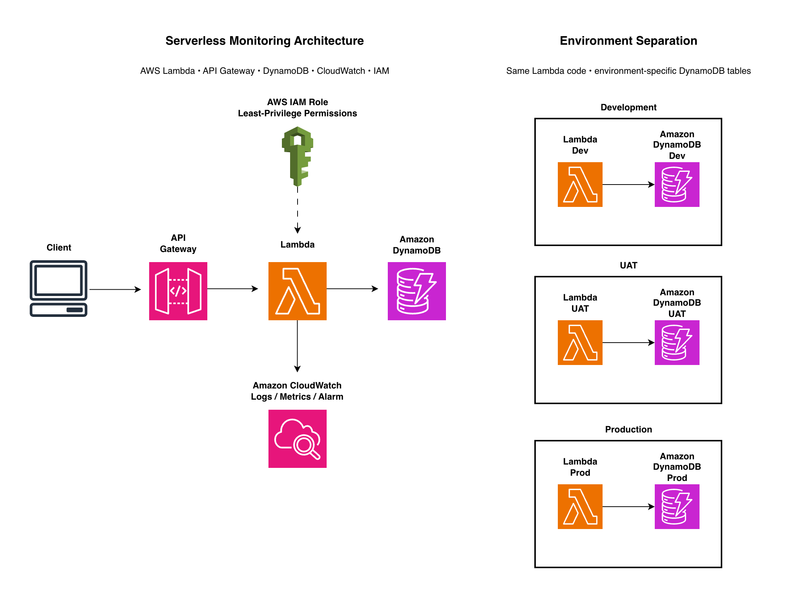

# AWS Serverless Monitoring

A production-style serverless AWS project demonstrating API-driven request processing, persistent DynamoDB storage, CloudWatch monitoring, least-privilege IAM and controlled promotion across Development, UAT and Production environments.

## Architecture

## Project Highlights

- Serverless request flow using API Gateway, Lambda and DynamoDB
- Development, UAT and Production environment separation
- Least-privilege IAM access to environment-specific DynamoDB tables
- CloudWatch runtime logging, metrics and alarm monitoring
- Controlled failure testing for troubleshooting
- 14-day CloudWatch log retention
- DynamoDB `PAY_PER_REQUEST` capacity mode

## Documentation

- [Architecture](docs/architecture.md)
- [Environment Setup](docs/environment-setup.md)
- [Monitoring and Troubleshooting](docs/monitoring-and-troubleshooting.md)
- [Project Decisions](docs/decisions.md)
- [Project Evidence](docs/evidence.md)
