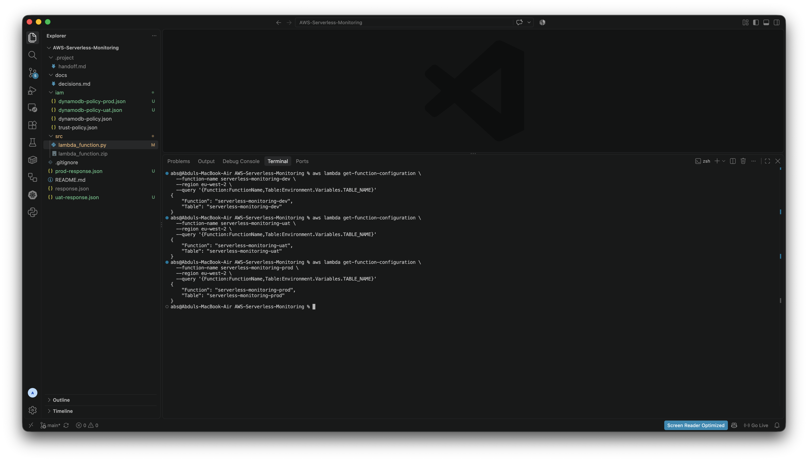

# Environment Setup

## Overview

The project uses separate Development, UAT and Production environments to demonstrate a controlled promotion workflow.

The same Lambda application code is reused across all three environments while environment-specific configuration determines which DynamoDB table each function uses.

## Development

- Lambda: `serverless-monitoring-dev`
- DynamoDB: `serverless-monitoring-dev`
- Environment variable: `TABLE_NAME=serverless-monitoring-dev`
- API Gateway: `serverless-monitoring-dev`

Development is the primary environment used for integration testing, API access and monitoring configuration.

## UAT

- Lambda: `serverless-monitoring-uat`
- DynamoDB: `serverless-monitoring-uat`
- Environment variable: `TABLE_NAME=serverless-monitoring-uat`

UAT provides an isolated environment for validating the same application code before Production.

## Production

- Lambda: `serverless-monitoring-prod`
- DynamoDB: `serverless-monitoring-prod`
- Environment variable: `TABLE_NAME=serverless-monitoring-prod`

Production uses the same tested Lambda code with its own isolated data store and IAM permissions.

## Promotion Workflow

The deployment model follows:

`Development → UAT → Production`

This demonstrates a common company workflow where the same application artifact moves through increasingly controlled environments rather than maintaining different code for each stage.

## Environment Isolation

Each Lambda function has:

- its own DynamoDB table
- its own `TABLE_NAME` configuration
- its own environment-specific DynamoDB IAM policy

This reduces the risk of Development or UAT workloads affecting Production data.

## Evidence

**What it shows:**  
The Development, UAT and Production Lambda functions each use their own environment-specific DynamoDB table configuration.

**What it proves:**  
The environments are isolated from one another while using the same Lambda application code.

**Real-world context:**  
This mirrors a common deployment model where the same application is promoted through Development, UAT and Production while keeping configuration and data separated.
