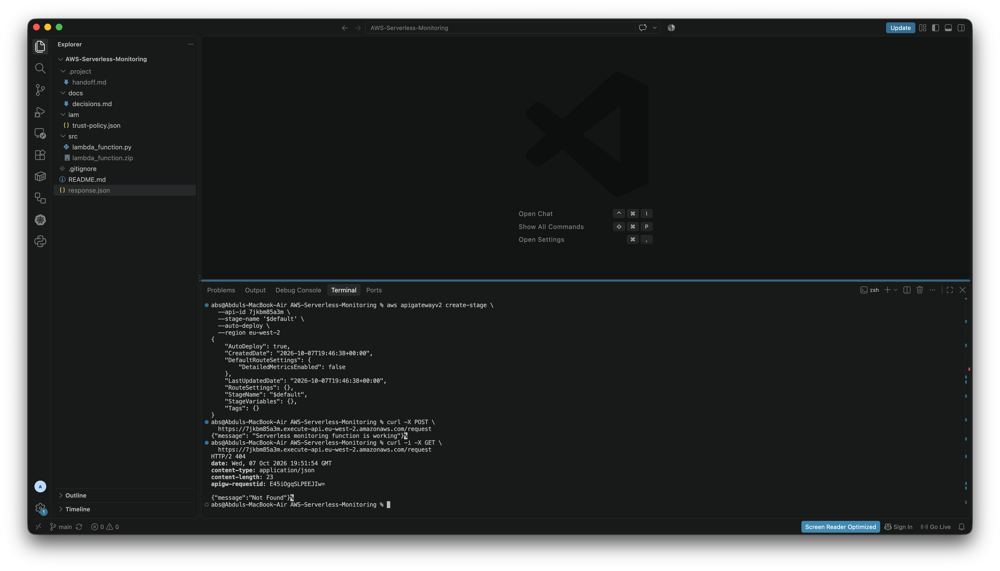
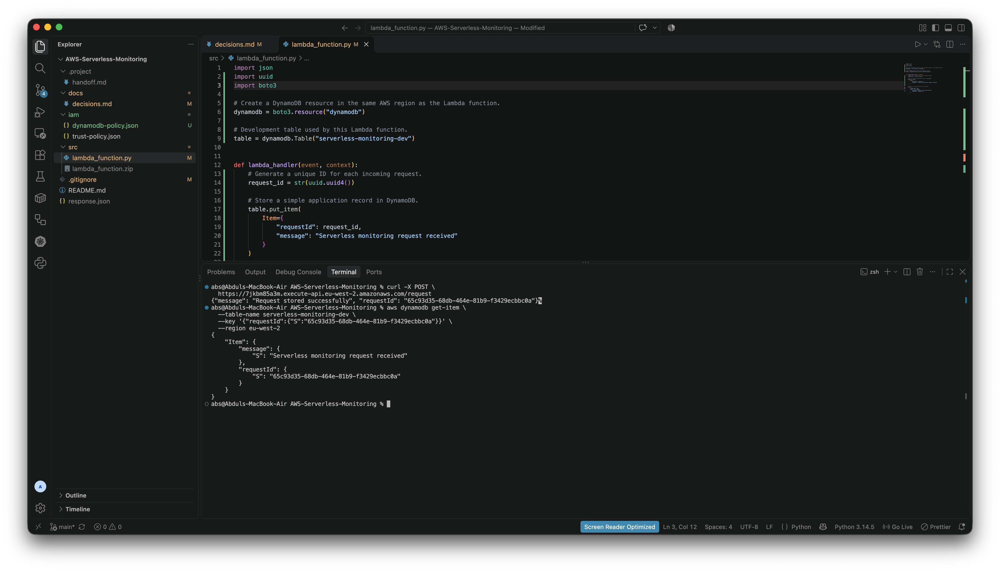
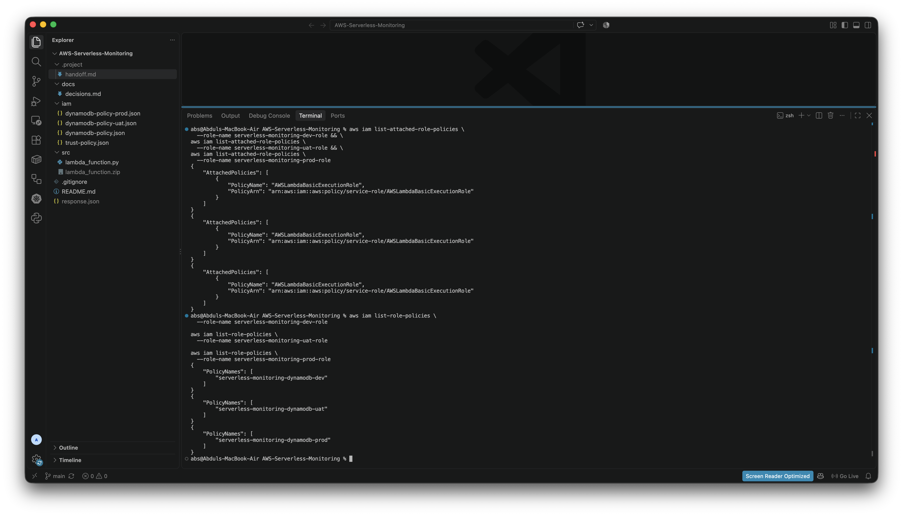

# Project Evidence

This page contains selected verification screenshots captured during the project.

## API Gateway Request Validation

**What it shows:**  
`POST /request` succeeds with the Lambda response while `GET` returns HTTP 404.

**What it proves:**  
API Gateway connects to Lambda over HTTPS and enforces the intended HTTP method.

**Real-world context:**  
A company backend endpoint accepts the supported request method and rejects unsupported calls.

## DynamoDB Write and Read Verification

**What it shows:**  
API Gateway triggered Lambda to store an item, and the same `requestId` was used to retrieve it from DynamoDB.

**What it proves:**  
Persistence, retrieval, the Lambda-to-DynamoDB integration and IAM permissions are working.

**Real-world context:**  
This mirrors storing customer requests, orders or application events for later lookup.

## IAM Least-Privilege Review

**What it shows:**  
The Development, UAT and Production Lambda roles each have the basic Lambda execution policy plus their own environment-specific DynamoDB policy.

**What it proves:**  
Access is separated by environment, supporting least privilege and reducing the risk of one Lambda accessing another environment's data.

**Real-world context:**  
This reflects how production teams isolate permissions between Development, UAT and Production to reduce blast radius and protect live resources.
