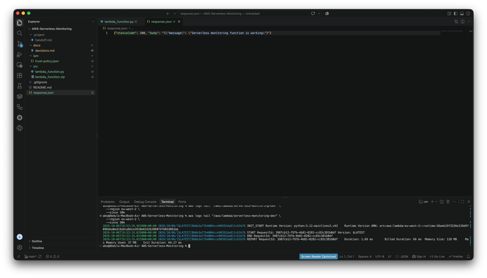
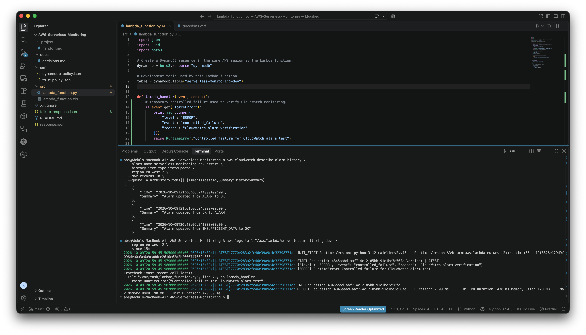
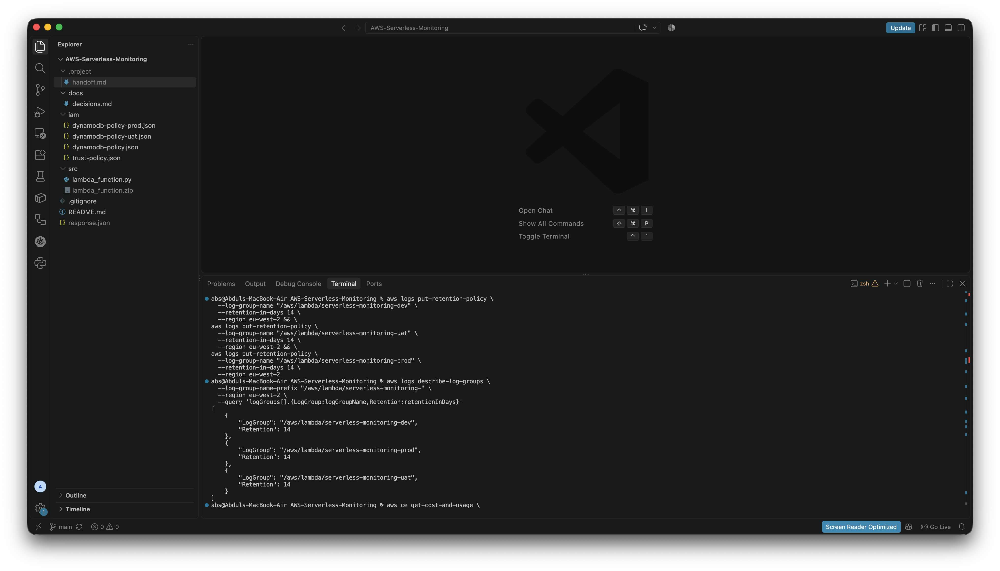

# Monitoring and Troubleshooting

## Overview

Amazon CloudWatch is used to monitor Lambda execution, review runtime logs, track errors and retain recent operational history.

The project also includes a controlled failure test to demonstrate how CloudWatch can be used to detect and investigate problems.

## Lambda Runtime Logs

**What it shows:**  
CloudWatch log output generated by the Lambda function during execution.

**What it proves:**  
Lambda executions are producing operational logs that can be reviewed during troubleshooting.

**Real-world context:**  
Engineers use runtime logs to understand what happened during an application request and investigate failures.

## Alarm Testing and Troubleshooting

**What it shows:**  
A controlled Lambda failure being detected through CloudWatch monitoring and the configured error alarm.

**What it proves:**  
The monitoring setup can identify application errors and provide a clear troubleshooting signal.

**Real-world context:**  
Production teams use alarms to surface failures quickly instead of relying on users to report problems first.

## Log Retention

**What it shows:**  
The Development, UAT and Production Lambda log groups configured with a 14-day retention period.

**What it proves:**  
Logs are retained long enough for recent troubleshooting without being stored indefinitely.

**Real-world context:**  
Defined retention periods help balance operational visibility, storage cost and log-management hygiene.
